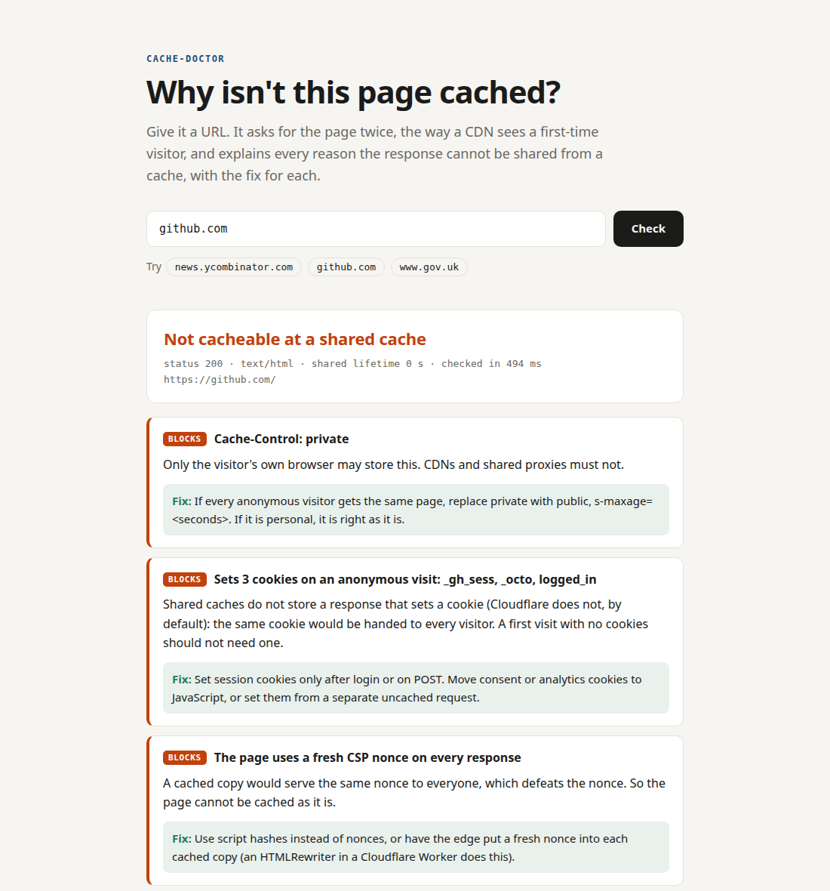

# cache-doctor

A page that a CDN could serve in a few milliseconds goes back to the origin on every request, and the reason is
usually one header nobody remembers adding. cache-doctor fetches a URL the way a CDN sees a first-time visitor and
explains every reason the response cannot be shared from a cache, with the fix for each.

**Live: [cache-doctor.ahmed-abied.workers.dev](https://cache-doctor.ahmed-abied.workers.dev)**



## Try it in under a minute

From your own machine (Node 22.18 or newer):

```sh
npx github:Ahmedabied/cache-doctor github.com
```

```
https://github.com/
  verdict: not cacheable at a shared cache (3 blocking, 2 hurting)
  status 200, text/html, 512.0 KB, shared lifetime 0 s, checked in 154 ms

  BLOCKS  Cache-Control: private
          Only the visitor's own browser may store this. CDNs and shared proxies must not.
          fix: If every anonymous visitor gets the same page, replace private with public,
          s-maxage=<seconds>. If it is personal, it is right as it is.

  BLOCKS  Sets 3 cookies on an anonymous visit: _gh_sess, _octo, logged_in
  BLOCKS  The page uses a fresh CSP nonce on every response
  HURTS   Every request goes back to the origin (a lifetime of 0 seconds)
  HURTS   Vary: Accept-Language
```

`--json` prints the full report. The exit code is 0 when the page is cached or cacheable, 1 when it is not (or when
the cache hands every visitor the same cookie), and 2 when the check failed or the site refused it, so it can run in
CI against your own pages.

## What it checks

It asks for the page twice, back to back, with no cookies, and compares the two answers.

| Area | What it looks for |
|---|---|
| Cache-Control | `no-store`, `private`, `no-cache`, `max-age=0` without `s-maxage`, short lifetimes, and the targeted `CDN-Cache-Control` and `Cloudflare-CDN-Cache-Control` headers that override it for CDNs |
| Status | statuses a cache only stores when told how long or marked `public` (302, 307, 500, 503 and others); a 401, 403 or 429 is reported as the site refusing the check, and a Cloudflare 520 to 530 as Cloudflare not reaching the site, neither diagnosed as the page |
| Lifetimes | no lifetime at all (HTML versus static files), a `max-age` that is not a number (stale, RFC 9111 4.2.1), `Expires` in the past or not a real HTTP date (expired, RFC 9111 5.3), legacy `Pragma` |
| Cookies | `Set-Cookie` on an anonymous visit, by name; `private="Set-Cookie"` and `no-cache="Set-Cookie"`, the standard way to cache the page without the cookie (with the RFC's warning that many caches do not support it); cookies a CDN adds at the edge (`__cf_bm`, Akamai and Imperva bot cookies) are recognised and not blamed on the origin |
| Vary | `*`, `Cookie`, `Authorization`, `User-Agent`, `Accept-Language` |
| The URL | tracking parameters (`utm_*`, `gclid`, `fbclid` and others) that split the cache key, and cache busters |
| The body | what differs between the two anonymous responses: per-visitor CSRF tokens, CSP nonces, timestamps and request ids, shown with their context and the values masked |
| The CDN | Cloudflare, Fastly, CloudFront, Vercel, Netlify, Akamai, and the standard `Cache-Status` header (parsed as the RFC 9211 list; only a real `hit` counts, and `HIT-FOR-PASS` is a miss). A HIT on the second request is proof the CDN caches the page, so it decides the verdict. If that hit carries the very same `Set-Cookie` as the first response, the cache is handing one visitor's cookie to everyone: that is a blocker |

30 finding types in all, each with a test.

## Measured

`node bench/survey.ts` checked the homepages of 50 well-known sites (public services, news, developer tools,
shops), two anonymous requests each, on 2026-11-09:

| | |
|---|---|
| sites that answered | 49 |
| time to diagnose, median | 706 ms (both fetches and the analysis) |
| time to diagnose, p90 | 1.7 s |
| already served from their CDN's cache | 21 (43%) |
| cannot be shared from a cache as served | 11 (22%) |
| refused an unknown client | 9 (18%) |
| set a cookie on an anonymous first visit | 13 (27%) |
| send a fresh CSP nonce on every response | 5 (10%) |

The analysis itself takes about 7 ms for a 480 KB page; the rest is the network. The full list is in
[bench/sites.txt](bench/sites.txt).

## The web page

The [demo](https://cache-doctor.ahmed-abied.workers.dev) is a Cloudflare Worker that uses the same code as the
command line tool. It is built so it cannot be turned into a proxy or pointed inward:

- Only the diagnosis comes back, never the fetched page. Bodies are read up to 200 KB and then dropped.
- It refuses IP addresses, ports other than 80 and 443, credentials in the URL, and internal names (`localhost`,
  `.internal`, `.local` and similar). Every redirect is checked against the same rules. These are name checks
  only: a public name that resolves to a private address (`localtest.me`, `127.0.0.1.nip.io`) passes them. What
  stops those is Cloudflare's network, which will not fetch private addresses from a Worker and answers 530; the
  page reports that as "could not be reached", not as the site's caching.
- 10 checks a minute per address (Workers rate limiting), and the same URL within a minute is answered from the
  edge cache without fetching again.
- Strict Content-Security-Policy, no outside scripts, and results are rendered as text, never as HTML.
- The page passes its own check: `public, max-age=300, s-maxage=3600, stale-while-revalidate=600`.

To run your own: `npx wrangler deploy` (set `CLOUDFLARE_ACCOUNT_ID` if you have several accounts).

## Limits

- **It sees what an anonymous first visit sees, from one place.** Logged-in pages, and caching that differs by
  country, are out of its sight.
- **A CDN may get its own instructions.** Origins often send `Surrogate-Control` or rely on CDN rules, and the CDN
  removes them before the response reaches anyone. The headers cache-doctor reads are the ones browsers get. That
  is why an observed HIT wins: it is the only proof of what the CDN does.
- **From the Worker, Cloudflare is half blind.** Cloudflare adds `cf-*` headers and rewrites `server` on every
  fetch a Worker makes, so the web page cannot read Cloudflare's own cache status, and some sites refuse cloud
  addresses. The command line tool, run from your machine, sees both.
- **The body comparison is a heuristic.** It finds what changed between two responses and names it from the words
  around it. It reads the first 512 KB (200 KB on the web page).
- **CDN defaults differ.** Where a fix mentions a default, it is Cloudflare's documented behaviour.

## Development

```sh
npm ci
npm test            # 36 tests: every finding, the probe and CLI against a local server
npm run typecheck   # the library and the Worker
npm run compile     # rebuild dist/src (committed, so `npx github:` needs no dev tools; CI checks it is current)
npx wrangler dev    # the page on localhost:8787
```

TypeScript, no runtime dependencies. Tests run on Node's own test runner and type stripping.

Built with AI pair programming.

## Licence

MIT
